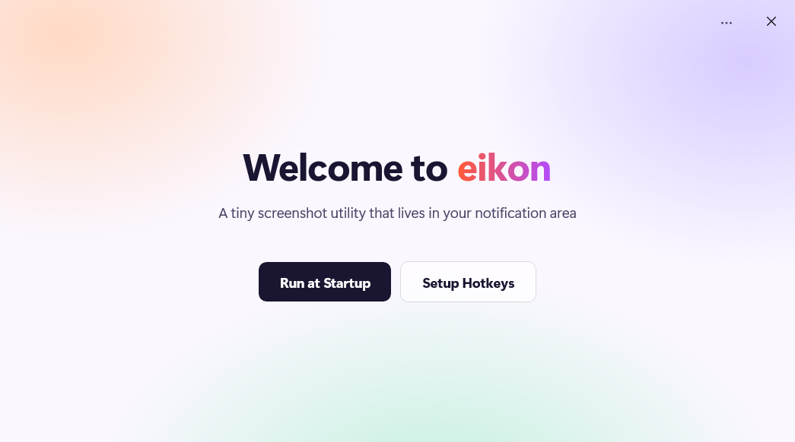
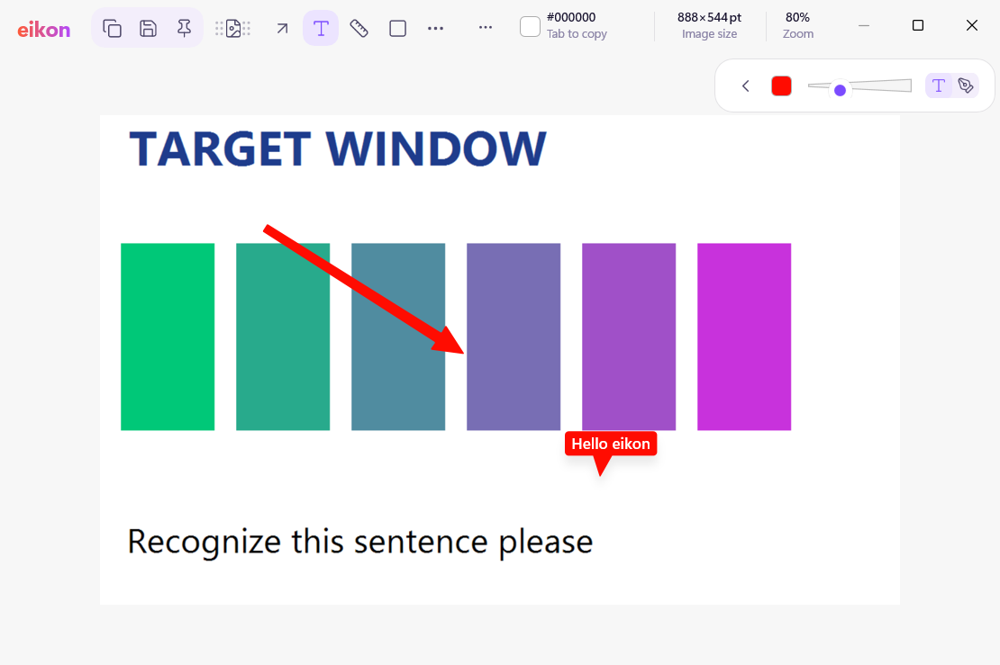

# Eikon

Eikon is a screenshot tool for Windows 11. It lives in the notification area, captures an area, a
window, the whole screen or a scrolling page, and opens the result in a fast annotation editor where
you can crop, draw, blur, measure, pick colours, add a backdrop and then save, copy, pin or drag the
image out. It is a native WinUI 3 app written in C++.

**[Download Eikon](https://github.com/Marshall2HD/eikon/releases/latest)**: take the x64 zip (ARM64 for
Snapdragon PCs), extract it and double-click `Install.cmd`. Windows asks once to trust Eikon's signing
certificate, then Eikon installs and starts in the notification area.





## Features

- **Capture:** area (with window highlighting), any window, fullscreen, repeat the last area,
  delayed, and scrolling capture that stitches a long page into one image.
- **After a capture:** open the editor or show a small floating thumbnail you can drag, copy, save or
  pin.
- **Editor:** arrows, lines, rectangles, ovals, freehand and highlighter, text, numbered counters,
  blur and erase, spotlight, a magnifier, pasted images, a pixel ruler, a colour picker with contrast checks (WCAG 2 and APCA), crop and
  resize, undo, and backdrops with padding, shadows, gradients and wallpapers.
- **Cut Out:** lifts the subject of a selection from its background (Windows AI where available,
  otherwise a bundled on-device model).
- **OCR:** copies the text of any area with Windows' on-device OCR, or a QR code's contents.
- **Pin** any image above other windows, at any zoom.
- **Library:** a searchable gallery of your screenshots folder that follows changes made outside the app.
- **Upload** to your own S3-compatible bucket (optional).
- **Automation:** `eikon://` URLs (`eikon://grab/area`, `eikon://grab/fullscreen`, `eikon://ocr`, …).
- Light, dark and high-contrast themes.

## Default hotkeys

| Action | Hotkey |
|---|---|
| Fullscreen capture | <kbd>Ctrl</kbd>+<kbd>Shift</kbd>+<kbd>1</kbd> |
| Area capture | <kbd>Ctrl</kbd>+<kbd>Shift</kbd>+<kbd>2</kbd> |
| Copy text (OCR) | <kbd>Ctrl</kbd>+<kbd>Alt</kbd>+<kbd>Shift</kbd>+<kbd>O</kbd> |

They can be changed in Settings → Hotkeys, which can also take over <kbd>Print Screen</kbd> from the Snipping Tool.

## Building

Eikon builds with Visual Studio 2022 or MSBuild on Windows 11:

```powershell
msbuild Eikon.sln /t:Restore /p:Configuration=Release /p:Platform=x64
msbuild Eikon.sln /m /p:Configuration=Release /p:Platform=x64
```

See [docs/building.md](docs/building.md) for the requirements, the test runner, a sideload package
signed with your own certificate and the asset generators, and [docs/ARCHITECTURE.md](docs/ARCHITECTURE.md)
for how the code is organised.

## Licence

Eikon is released under the [MIT licence](LICENSE).

### Third-party notices

| Component | Use | Licence |
|---|---|---|
| [Lucide](https://lucide.dev) 1.70.0 | tool and UI icons | ISC (Feather-derived icons MIT), [`third_party/lucide/LICENSE`](third_party/lucide/LICENSE) |
| [ZXing-C++](https://github.com/zxing-cpp/zxing-cpp) 3.1.1 | QR code reading | Apache-2.0 (libzueci BSD-3-Clause), [`third_party/zxing-cpp/LICENSE`](third_party/zxing-cpp/LICENSE) |
| [U²-Net-p](https://github.com/xuebinqin/U-2-Net), ONNX export by [rembg](https://github.com/danielgatis/rembg) | Cut Out's subject model | Apache-2.0 (export MIT), [`third_party/u2net/LICENSE`](third_party/u2net/LICENSE) |
| [Win2D](https://github.com/microsoft/Win2D), [C++/WinRT](https://github.com/microsoft/cppwinrt), [WIL](https://github.com/microsoft/wil) | canvas rendering, WinRT projection, helpers | MIT, via NuGet |
| [Windows App SDK](https://github.com/microsoft/WindowsAppSDK) | WinUI 3, app runtime, ONNX Runtime | Microsoft licence terms of the NuGet package |
